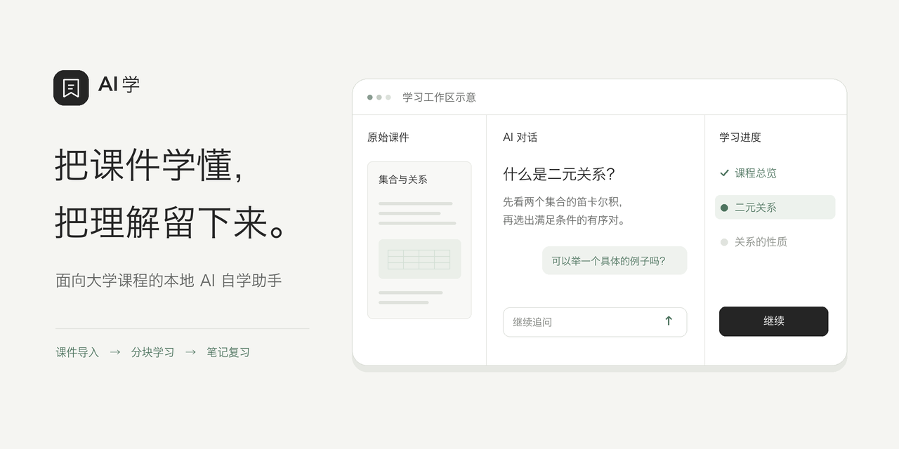

# AI 学

AI 学是面向大学课程的本地自学助手。对照原始课件和 AI 逐块学习，自己确认进度，最后把本次学过的内容整理成 Markdown 笔记。



## 从这周的课开始

- **学习**　从本周课表选一节课导入，自动带入课程和教学周。也可以直接导入 PDF、PPTX、DOCX、Markdown 或 TXT，让 AI 辅助识别资料信息。
- **讲解与追问**　左边看原件，中间读总览和分块讲解、随时提问，右边看进度。按「继续」才推进，追问保留在当前学习块。
- **复习**　结束学习后整理笔记。按课程、周次和课堂类型查找，阅读时按需打开批注和 AI 对话，也可导出 Markdown。
- **学习设置**　日历支持日、周、月、年视图，可导入校历、课表和考试信息，订阅 iCalendar 链接，或从 Module Handbook 提取考试信息。「课堂分类」可为不同课堂类型选择模板，「讲解与笔记」分别编辑学习讲解和笔记整理的提示词。

## 在本机启动

准备 Git 和 Python 3.11 或以上版本。在 macOS 或 Linux 的终端中运行：

```sh
git clone https://github.com/zde2071-blip/ai-xue.git
cd ai-xue
python3 -m venv .venv
.venv/bin/python -m pip install -r requirements.txt
.venv/bin/python server.py
```

在浏览器打开 `http://127.0.0.1:8767/`，创建本地账户。macOS 安装依赖后也可以双击「启动学记.command」。前端资源已随仓库提供，日常启动无需 Node.js。要在学习页内预览 Word 或 PowerPoint 原件，请安装 LibreOffice。

在左下角「账户设置 → AI 服务」添加模型连接。支持 OpenAI 兼容接口和 Claude 原生接口。识别日历图片时需要支持图像输入的模型，识别结果可先核对再保存。

## 数据保存在哪里

课件原件、笔记、旁注和学习日历保存在本机知识库中。已归档的校历、课表或考试文件可以从日历来源设置打开。建议一起备份账户对应的知识库和 `.local/`。调用 AI 时，相关资料和问题会发送给所选服务商。API Key 仅保留在运行中的服务内存，重启后需重新填写。

## 开发与反馈

前端是 [HTML、CSS 和 JavaScript](web/)，后端入口为 [server.py](server.py)。

```sh
.venv/bin/python -m unittest discover -s tests -v
node --test tests/*.cjs
```

遇到问题可以在 [Issues](https://github.com/zde2071-blip/ai-xue/issues) 说明复现步骤、操作系统和浏览器。提交截图或样例前请移除私人课件、日历订阅链接和凭据。
